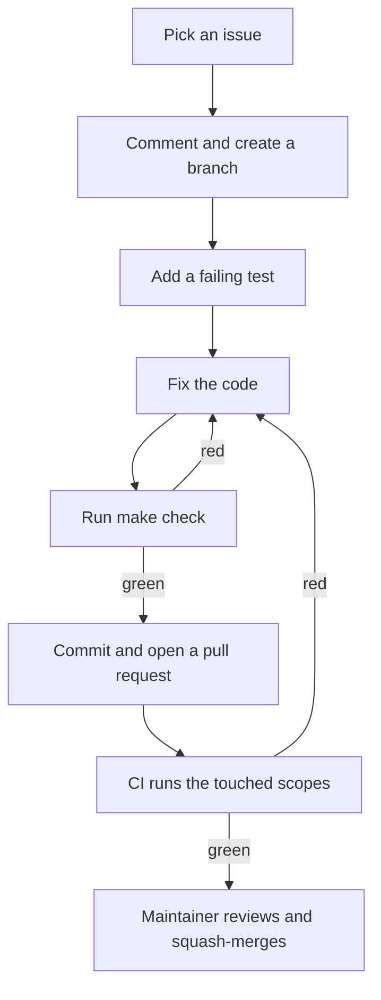

# Contributing to ros2serial

This guide takes a new developer from a fresh clone to a merged pull
request. It reads in about ten minutes. [`AGENTS.md`](AGENTS.md) is the
full rulebook for the project. It wins on any conflict. This guide shows
the everyday path. That file settles every question this guide skips.

Timings marked "local" come from a real run on a developer machine.
Timings marked "CI" come from a recent passing run of `ci.yml` on
`master`. Both drift with hardware and load. Treat them as rough sizes,
not promises.

## What you need

Docker, `make` and `git`. Nothing else goes on the host.

The compiler, ROS 2, the simulator and the Python tooling all live in
the dev image. That keeps every machine identical, which is why a local
run matches CI. Nothing toolchain-related is ever installed on the host.

## Your first session

Clone and set up:

```sh
git clone https://github.com/apojomovsky/ros2serial.git
cd ros2serial
make bootstrap
```

`bootstrap` checks the host dependencies, installs the git hooks and
builds the dev image. The first build takes several minutes. On a
machine that is already set up it finishes at once (local):

```text
ok       git
ok       make
ok       docker
ok       docker daemon reachable
ok       dev image ros2serial-dev:9f07976c03ee
ok       git hooks installed
git hooks installed (core.hooksPath = .githooks)
ros2serial-dev:9f07976c03ee is up to date
```

Check that the setup is whole. This command changes nothing:

```sh
make doctor
```

A healthy host prints one `ok` per line (local):

```text
ok       git
ok       make
ok       docker
ok       docker daemon reachable
ok       dev image ros2serial-dev:9f07976c03ee
ok       git hooks installed
```

The image tag differs on your machine. The word that matters is `ok`.

Next, run the gates and the scopes your diff needs:

```sh
make check
```

On a tree with no changes this takes a few seconds and ends with
(local):

```text
== layout: ok
== python-lint: ok
== c-format: ok
== cppcheck: ok
== workflow-lint: ok
== vectors: ok
...
== commits: ok
== prose: ok
all sections passed
```

Each `== name` line is one gate. A failing gate prints its section
without the `ok`. When your diff touches code, `check` also runs each
touched scope, so it takes longer.

Then run one real test scope, the C core:

```sh
make test-core
```

This builds the core and its tests inside the image. It ends with
`== core: ok` and `all sections passed`. It took under a minute locally.
The same scope runs as the `core` job in CI in about two minutes.

`make help` lists the everyday targets: `check`, `test-core`,
`test-gen`, `test-bridge`, `test-cpp`, `test-scripts`, `test-all`,
`e2e-posix`, `e2e-avr`, plus `pytest` and `ctest` for single files or
tests.

## Finding work

Work lives in the
[issues](https://github.com/apojomovsky/ros2serial/issues). Issues
labelled `good first issue` are scoped for a newcomer. Say you are
taking one with a short comment on the issue, so two people never do
the same work twice.

Create one branch per issue, from `master`:

```sh
git checkout -b fix/123-short-slug master
```

The name is `<type>/<issue>-<slug>`: the commit type (`fix`, `feat`,
`docs`, and the rest), the issue number, and a few words of slug. One
ticket gets one branch and one pull request.

## The loop

1. **Write a failing test first.** It proves the bug exists before the
   fix, and it proves the fix works after.
2. **Make the fix.** Keep it to the one issue. Small diffs get
   reviewed faster.
3. **Run `make check`.** It runs the gates and every scope your diff
   touches. CI runs the same script, so a scope that is green here
   stays green there. A diff that maps to the full suite still runs
   only the fast gates locally, leaving the rest to CI.
4. **Commit with a Conventional Commit subject.** One line, at most
   three lines total, for example `fix(core): ...`. The scope names the
   area. No trailers and no em-dashes. The style matters because the
   squash merge lands the pull request title as the one commit on
   `master`, and the changelog is built from these subjects.
5. **Open a pull request when it is ready for review.** Put `Closes #N`
   in the body. The link closes the issue on merge. The maintainer adds
   the issue's `area:*` labels, since outside contributors cannot label.

## When CI is red

Each CI job in `.github/workflows/ci.yml` maps to one local target.
Run that target inside the image and you see the same failure CI saw:

| CI job | Local reproduction |
| --- | --- |
| `plan` | No local run. `make check` prints the scopes CI would run for the diff |
| `lint` | `make test LINT=1` |
| `scripts` | `make test-scripts`, or one shard with `make test SCRIPTS=1 SCRIPTS_SHARD=N` |
| `core` | `make test-core` |
| `gen` | `make test-gen` |
| `cpp` | `make test-cpp` |
| `docs` | `make test DOCS=1` |
| `readme` | `make test README=1` |
| `coverage` | `make test COVERAGE=1` |
| `e2e-avr` | `make e2e-avr` |
| `bridge` | `make test-bridge` |
| `e2e-posix` | `make e2e-posix` |
| `fuzz-smoke` | `make test FUZZ=1` |
| `build-matrix` | `make test EXAMPLES=1` |
| `budgets` | `make test BUDGETS=1` |

Two jobs have no local twin. `bridge-images` is CI setup: it only reads
`ci/versions.env` to pick the bridge images. `plan` only reports which
tasks are stale; `make check` shows you its answer.

Read the failure in the job log: open the failed job in the Actions tab,
or run `gh run view <run-id> --log-failed`. Fix the cause, not the
symptom, and push the fix. A failure your diff cannot reach may be a
flake: rerun that job once with `gh run rerun <run-id> --failed`. If it
fails again, say so on the pull request instead of rerunning it.

## FAQ

**The dev image is stale.** Rebuild it with `make image`. The tag is
content-addressed, so a rebuild with no changes finishes at once. If
`make doctor` reports the image missing, run `make bootstrap` again.

**Merging without conflicts.** `.gitattributes` routes sources to the mergiraf structural merge driver, generated files to keep-our-side plus regeneration, and one-item-per-line lists to union merge. mergiraf itself is optional: install it (for example with `cargo install mergiraf`) and re-run `make setup-hooks`, which registers this clone's merge drivers. Without it git merges lines as usual.

**A test is flaky.** Rerun just its scope, for example `make test-core`.
The simulator runs at its own pace, so a timing failure that passes
alone and fails under load is usually the load. In CI, rerun the failed
jobs once. If they fail again, report it on the pull request.

**My editor wants headers.** Install nothing on the host. The compilers
and ROS headers exist only inside the dev image, by design. Open a
shell there with `make shell` to browse them.

## The whole flow



Anything this guide leaves open is settled in
[`AGENTS.md`](AGENTS.md), which stays normative.
