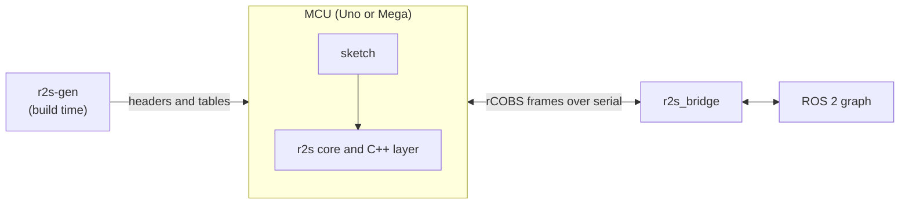

# ros2serial

ROS 2 topics from small microcontrollers, down to an 8-bit Arduino Uno, over a serial link. For builders coming from rosserial, or starting fresh on AVR, who want plain publish and subscribe without an RTOS or a network stack.

**Status:** pre-release. The stack runs end to end on the posix virtual MCU and on emulated Uno and Mega boards; real-hardware runs are not verified yet ([#95](https://github.com/apojomovsky/ros2serial/issues/95)).

[](https://github.com/apojomovsky/ros2serial/actions/workflows/ci.yml)

The payoff, at the end of either walkthrough below (the emulated Uno reads 0.0; the virtual MCU counts up):

```sh
ros2 topic echo /battery std_msgs/msg/Float32 --once
```

```text
data: 0.0
```

## Contents

- [Getting started](#getting-started)
- [How it fits together](#how-it-fits-together)
- [What works today](#what-works-today)
- [Limits](#limits)
- [rosserial and micro-ROS](#rosserial-and-micro-ros)
- [Contributing](#contributing)
- [License](#license)

## Getting started

Publish your first topic in one sitting. Every command below also runs in CI against the checked-in walkthrough (`scripts/check-readme.sh`), so the steps cannot drift from the code.

### 1. On an Arduino Uno first

No hardware needed for the first pass: the sketch below runs on an emulated Uno, and step 2 flashes the same build to a real one. The firmware runs a `battery` publisher and a `cmd_vel` subscription as an Arduino sketch, using the runtime API: topics are objects declared in the sketch, so there is no `r2s.yaml` and no generated code. The example sketch is `examples/arduino_minimal`, a node called `base_controller` with a one-line loop:

```text
r2s::Node node("base_controller");
r2s::Publisher<std_msgs::msg::Float32> battery_pub(node, "battery");
void loop()  { battery.data = read_battery(); battery_pub.publish(battery); node.spin_some(); }
```

Task-shaped sketches with the same API live beside it: `arduino_hello` (`chatter` publisher), `arduino_blink` (`led` subscription driving the LED), `arduino_button` (debounced `button` publisher), `arduino_servo` (`servo` subscription setting the angle), `arduino_range` (`range` publisher), and `arduino_action` (action server running one goal). Each header names the host commands to try it, and each builds for Uno and Mega in CI.

You need `arduino-cli` with the AVR core and `avr-gcc`, plus libsimavr for the emulated run. One helper stages the Arduino library (the generator bundle, the core, the port glue and the runtime layer) and compiles the sketch, installing the AVR core when it is missing:

```sh
git clone https://github.com/apojomovsky/ros2serial.git
cd ros2serial
pip install ./gen
bash ports/arduino/build.sh --board uno
```

Build the simavr harness and start the firmware on it. It prints the pty the emulated UART is bridged to:

```sh
R2S_BUILD_DIR=$PWD/build bash tests/harness/simavr/run.sh --build-only
build/harness/simavr/r2s_simavr --mcu atmega328p --firmware build/uno/arduino_minimal.ino.elf --run-ms 300000
```

```text
r2s_simavr: pty=/dev/pts/0
```

In a second shell, build the bridge and launch it on that pty:

```sh
source /opt/ros/jazzy/setup.bash
colcon build --base-paths bridge --build-base build/bridge/build --install-base build/bridge/install
source build/bridge/install/setup.bash
ros2 launch r2s_bridge r2s_bridge.launch.py port:=/dev/pts/0 &
ros2 topic list
```

```text
/battery
/cmd_vel
/diagnostics
/parameter_events
/rosout
```

One reading proves the whole path:

```sh
ros2 topic echo /battery std_msgs/msg/Float32 --once
```

```text
data: 0.0
```

The example publishes a fixed 0.0 reading, so that number proves the sketch, the emulator and the bridge agree.

### 2. On real hardware

Not yet verified on hardware ([checklist](https://github.com/apojomovsky/ros2serial/issues/95)). Flash the same build to an Uno and point the bridge at the serial port instead of the pty:

```console
arduino-cli upload -p /dev/ttyACM0 --fqbn arduino:avr:uno --input-dir build/uno examples/arduino_minimal
ros2 launch r2s_bridge r2s_bridge.launch.py port:=/dev/ttyACM0
ros2 topic echo /battery std_msgs/msg/Float32 --once
```

The Uno resets when its serial port opens, then runs its bootloader before your sketch starts. The bridge waits this out: `boot_wait_ms` in `bridge/r2s_bridge/config/r2s_bridge.params.yaml` defaults to 2500 ms, which covers the reset and the bootloader. If your board enumerates differently, substitute its port (often `/dev/ttyUSB0`) for `/dev/ttyACM0` in both commands.

### 3. Without hardware: the virtual MCU

No board and no emulator to hand: the posix port runs the unmodified core as a host process on a virtual serial line. You need ROS 2 Jazzy with `colcon`, Python 3.10 or newer with `pip`, and a host compiler (`cmake`, `gcc`).

Install the generator and build the virtual firmware:

```sh
git clone https://github.com/apojomovsky/ros2serial.git
cd ros2serial
pip install ./gen
export R2S_BUILD_DIR=$PWD/build
bash ports/posix/run.sh --build-only
```

Tie two virtual serial ports together and start the firmware on one end. It announces a `battery` publisher and a `cmd_vel` subscription:

```sh
python3 ports/posix/pty_pair.py > build/posix/ports.env &
sleep 1
set -a; source build/posix/ports.env; set +a
build/ports/posix/r2s_posix_firmware "$MCU_PORT" &
```

Build the bridge and launch it on the other end:

```sh
source /opt/ros/jazzy/setup.bash
colcon build --base-paths bridge --build-base build/bridge/build --install-base build/bridge/install
source build/bridge/install/setup.bash
ros2 launch r2s_bridge r2s_bridge.launch.py port:="$HOST_PORT" &
ros2 topic list
```

```text
/battery
/cmd_vel
/diagnostics
/parameter_events
/rosout
```

(Excerpt: the firmware also announces its test topics `/echo_vel`, `/joints`, `/log_text` and `/time_now`.) One reading proves the whole path:

```sh
ros2 topic echo /battery std_msgs/msg/Float32 --once
```

```text
data: 27.0
```

Any number proves the path: the virtual MCU publishes its message counter as the reading.

## How it fits together



The generator runs once at build time and produces the firmware headers. At runtime the sketch and the core run on the MCU, exchange frames over the serial link with the bridge, and the bridge publishes and subscribes on the ROS 2 graph. The full map, from the sketch to the ROS 2 graph, lives in [`docs/02-architecture.md`](docs/02-architecture.md); the design rationale in [`docs/00-design.md`](docs/00-design.md). The published site mirrors these pages, with the final port guide: [ros2serial docs](https://apojomovsky.github.io/ros2serial/).

## What works today

Tested on every PR in CI. The wire is protocol v4 (`[GEN-2]` in `spec/protocol.md`).

- **APIs.** The C API (`r2s_publish_*`, `r2s_on_*`, `r2s_spin_some`), the runtime C++ API (`r2s::Node`, `r2s::Publisher`, `r2s::Subscription` with ROS 2 names), and the static C++ API over the `R2S_TOPICS` X-macro list. The C and runtime C++ firmwares run the whole end-to-end list below, except the services scenario, which only the C firmware runs; the static C++ and ros compat firmwares cover scenarios 1 to 4. Coming from rosserial? `ros::` compatibility aliases keep an existing sketch close to its original; see [Port your rosserial sketch](docs/03-port-rosserial-sketch.md).
- **Boards and ports.** Arduino Uno (ATmega328P) and Mega (ATmega2560), in simavr; the Arduino port (`Serial`), AVR bare metal, and the posix virtual MCU over a pty. Example sketches also build for the ESP32 Dev Module in CI. Real hardware is not verified yet ([#95](https://github.com/apojomovsky/ros2serial/issues/95)).
- **Distros and RMWs.** The bridge builds and is tested on Jazzy, Lyrical and Rolling; the generator bundles a snapshot per distro. End to end runs under Fast DDS, Cyclone DDS and Zenoh.
- **Message types.** The bundle ships fourteen common types: `builtin_interfaces/msg/Time`, `geometry_msgs/msg/Quaternion`, `geometry_msgs/msg/Transform`, `geometry_msgs/msg/TransformStamped`, `geometry_msgs/msg/Twist`, `geometry_msgs/msg/Vector3`, `sensor_msgs/msg/Imu`, `sensor_msgs/msg/JointState`, `sensor_msgs/msg/Range`, `std_msgs/msg/Bool`, `std_msgs/msg/Float32`, `std_msgs/msg/Header`, `std_msgs/msg/String`, `tf2_msgs/msg/TFMessage`, with documented default bounds.
- **Bridge features.** Full-mode handshake with hash check and `TOPIC_STATUS`, generic publishers and subscriptions with remapping, introspection-based packed-to-CDR conversion, Uno reset handling (`boot_wait_ms`, default 2500 ms), MCU parameters declared as ROS parameters on the bridge node, so `ros2 param set` reaches the MCU over the reliable channel, MCU log and error report forwarding to `/rosout`, host time-sync estimation, a stop-and-wait reliable channel for parameters, services and actions, per-topic route health with repair polling reported in `/diagnostics`, and per-topic rate limits with a host-to-MCU bandwidth cap. One bridge process serves up to 16 live links, with namespace and remapping launch arguments.
- **How it is tested.** Core unit, component, contract (every `spec/vectors/` file), and model-based tests; scenarios 1 to 4 and 6 to 14, plus a framing-fault variant and a publish catch-up test, end to end on the posix virtual MCU under every RMW; scenarios 1 to 4 and 12 on simavr for both chips under each RMW, plus the baud matrix; every walkthrough above runs green in CI (`scripts/check-readme.sh`).

## Limits

Serial only, best effort, bounded messages. The figures below come from `tools/budgets.yaml`, measured by `make size-report` with `avr-size`: the minimal example fits in about 12 KB of flash and 1.4 KB of RAM on an Uno, with a worst-case static stack around 200 bytes.

- No actions ([#318](https://github.com/apojomovsky/ros2serial/issues/318), [#319](https://github.com/apojomovsky/ros2serial/issues/319)) yet; services ([#156](https://github.com/apojomovsky/ros2serial/issues/156)) and the P1 spec work ([#316](https://github.com/apojomovsky/ros2serial/issues/316)) have landed
- WiFi or other network transports: ros2serial stays serial-only; see [Vision and non-goals](docs/00-design.md#vision-and-non-goals)
- Real-hardware checklist ([#95](https://github.com/apojomovsky/ros2serial/issues/95))

## rosserial and micro-ROS

rosserial covers ROS 1 from AVR boards over serial; this project brings that experience to ROS 2, with a generated packed encoding and a bridge node instead of a Python client. If your sketch already runs on rosserial, the port guide keeps most of it intact.

micro-ROS runs the full ROS 2 stack on the microcontroller itself, over DDS-XRCE on serial, UDP or TCP; it needs a 32-bit board and more memory. ros2serial instead keeps the MCU side to plain C with no RTOS and converts on the host, which is what fits an 8-bit Uno.

## Contributing

New here? Start with the quickstart in [`CONTRIBUTING.md`](CONTRIBUTING.md).

## License

MIT, see [`LICENSE`](LICENSE).
