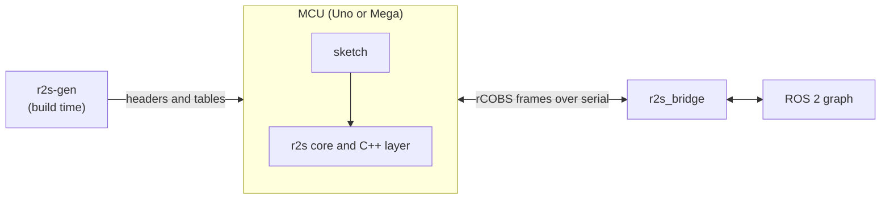

# ros2serial

rosserial for ROS 2: publish and subscribe to ROS 2 topics from small microcontrollers, down to an 8-bit Arduino Uno, over a serial link.

**Status:** pre-release. The stack runs end to end on an emulated Uno and Mega; the walkthrough below takes an emulated Uno to `ros2 topic echo`. Real-hardware runs are not verified yet (see [Not yet](#not-yet)). The design is in [`docs/00-design.md`](docs/00-design.md), and the work in the [issues](https://github.com/apojomovsky/ros2serial/issues).

## What it looks like

```cpp
#define R2S_NODE_NAME "base_controller"
#define R2S_TOPICS(X) \
  X(Publisher, std_msgs::msg::Float32, battery_pub, "battery") \
  X(Subscription, geometry_msgs::msg::Twist, cmd_vel_sub, "cmd_vel", on_cmd_vel)
#include <ros2serial.h>
```

Install the Arduino library, declare your topics, publish, call spin. On the host, a regular ROS 2 node bridges the serial port into the ROS 2 graph. The snippet above is the static C++ API, which exists today alongside the runtime C++ API and the C API (see [What works in 0.1.0](#what-works-in-010)).

## Context



The generator runs once at build time and produces the firmware headers. At runtime the sketch and the core run on the MCU, exchange frames over the serial link with the bridge, and the bridge publishes and subscribes on the ROS 2 graph.

## What works in 0.1.0

Tested on every PR in CI unless noted.

- **APIs.** The C API (`r2s_publish_*`, `r2s_on_*`, `r2s_spin_some`), the runtime C++ API (`r2s::Node`, `r2s::Publisher`, `r2s::Subscription` with ROS 2 names), and the static C++ API over the `R2S_TOPICS` X-macro list. All three run the same end-to-end scenarios.
- **Boards and ports.** Arduino Uno (ATmega328P) and Mega (ATmega2560), in simavr; the Arduino port (`Serial`), AVR bare metal, and the posix virtual MCU over a pty. Real hardware is not verified yet ([#95](https://github.com/apojomovsky/ros2serial/issues/95)).
- **Distros and RMWs.** The bridge builds and is tested on Jazzy and Lyrical; the generator bundles snapshots for Jazzy, Lyrical and Rolling. End to end runs under Fast DDS, Cyclone DDS and Zenoh.
- **Message types.** The bundle ships ten common types: `builtin_interfaces/msg/Time`, `geometry_msgs/msg/Quaternion`, `geometry_msgs/msg/Twist`, `geometry_msgs/msg/Vector3`, `sensor_msgs/msg/Imu`, `sensor_msgs/msg/JointState`, `sensor_msgs/msg/Range`, `std_msgs/msg/Float32`, `std_msgs/msg/Header`, `std_msgs/msg/String`, with documented default bounds.
- **Bridge features.** Full-mode handshake with hash check and `TOPIC_STATUS`, generic publishers and subscriptions with remapping, introspection-based packed-to-CDR conversion, Uno reset handling (`boot_wait_ms`, default 2500 ms), MCU log and error report forwarding to `/rosout`, host time-sync estimation, and per-topic rate limits with a host-to-MCU bandwidth cap.
- **How it is tested.** Core unit, component, contract (every `spec/vectors/` file), and model-based tests; scenarios 1 to 4 end to end on the posix virtual MCU and on simavr for both chips and both C++ registration paths; the walkthrough below runs green in CI on simavr (`scripts/check-readme.sh`).

## Not yet

Planned work, each with its issue. The design marks these as P1, Phase 2+, or out of scope.

- Parameters ([#155](https://github.com/apojomovsky/ros2serial/issues/155), spec [#133](https://github.com/apojomovsky/ros2serial/issues/133))
- Reliable channel ([#154](https://github.com/apojomovsky/ros2serial/issues/154))
- Services ([#156](https://github.com/apojomovsky/ros2serial/issues/156), spec [#316](https://github.com/apojomovsky/ros2serial/issues/316))
- Actions (out of scope for v1; spec [#316](https://github.com/apojomovsky/ros2serial/issues/316))
- Reconnect and reset handling ([#138](https://github.com/apojomovsky/ros2serial/issues/138))
- Link saturation and `TX_BUSY` ([#146](https://github.com/apojomovsky/ros2serial/issues/146))
- One live link per bridge process ([#122](https://github.com/apojomovsky/ros2serial/issues/122))
- Compact handshake and PIC ports (Phase 5)
- Real-hardware checklist ([#95](https://github.com/apojomovsky/ros2serial/issues/95))

## Getting started

Publish your first topic from an Uno. The firmware uses the runtime API:
topics are objects declared in the sketch, so there is no `r2s.yaml` and
no generated code. The example sketch is
`examples/arduino_minimal/arduino_minimal.ino`: a node called
`base_controller` with a `battery` publisher and a `cmd_vel` subscription,
and a one-line loop:

```text
r2s::Node node("base_controller");
r2s::Publisher<std_msgs::msg::Float32> battery_pub(node, "battery");
void loop()  { battery.data = read_battery(); battery_pub.publish(battery); node.spin_some(); }
```

You need ROS 2 Jazzy with `colcon` (the bridge is also tested on Lyrical),
`arduino-cli` with the AVR core and `avr-gcc`, Python 3.10 or newer with
`pip`, and libsimavr for the emulated run. Every command below also runs in
CI against simavr (`scripts/check-readme.sh`), so the steps cannot drift
from the code.

### 1. Install the generator

```sh
git clone https://github.com/apojomovsky/ros2serial.git
cd ros2serial
pip install ./gen
r2s-gen version
```

### 2. Install the Arduino library

The library is the generator bundle plus the core, the Arduino port glue
and the runtime layer:

```sh
LIB=~/Arduino/libraries/ros2serial
mkdir -p "$LIB/src/r2s"
r2s-gen bundle --distro jazzy --out "$LIB"
cp core/include/r2s/*.h "$LIB/src/r2s/"
cp core/src/*.c "$LIB/src/"
rm -f "$LIB/src/test_reset.c"
cp ports/arduino/r2s_arduino_port.cpp ports/arduino/r2s_arduino_port.h "$LIB/src/"
cp cpp/include/r2s/runtime.hpp "$LIB/src/r2s/"
cp cpp/src/runtime.cpp "$LIB/src/"
arduino-cli core install arduino:avr
```

### 3. Build the bridge

```sh
source /opt/ros/jazzy/setup.bash
colcon build --base-paths bridge --build-base build/bridge/build --install-base build/bridge/install
source build/bridge/install/setup.bash
```

Build outputs land under `build/`, which the checkout ignores.

### 4. Compile the example

The sketch's frame and nesting limits travel as flags, read from the
bundle the same way the example builds read them:

```sh
EXTRAS=$(python3 - "$LIB/src/r2s_bundled.h" <<'EOF'
import sys

from r2s_gen import layouts
from r2s_gen.msgs import MessageError

try:
    defines = layouts.build_defines(open(sys.argv[1]).read(), "src/r2s_bundled.h")
except (MessageError, OSError) as error:
    print(f"r2s-gen: error: {error}", file=sys.stderr)
    raise SystemExit(1)
print(" ".join("-D" + define for define in defines))
EOF
)
arduino-cli compile --fqbn arduino:avr:uno \
  --build-property "compiler.c.extra_flags=$EXTRAS" \
  --build-property "compiler.cpp.extra_flags=$EXTRAS" \
  --library "$LIB" --output-dir build/uno examples/arduino_minimal
```

### 5. Run it on the emulated Uno

Build the simavr harness and start the firmware on it. It prints the pty
the emulated UART is bridged to:

```sh
R2S_BUILD_DIR=$PWD/build bash tests/harness/simavr/run.sh --build-only
build/harness/simavr/r2s_simavr --mcu atmega328p --firmware build/uno/arduino_minimal.ino.elf --run-ms 300000
```

```text
r2s_simavr: pty=/dev/pts/0
```

### 6. Bridge it into ROS 2

In a second shell, with the ROS and bridge environments sourced, launch
the bridge on that pty and watch the topic:

```sh
source /opt/ros/jazzy/setup.bash
source build/bridge/install/setup.bash
ros2 launch r2s_bridge r2s_bridge.launch.py port:=/dev/pts/0
```

```sh
ros2 topic list
```

```text
/battery
/cmd_vel
/diagnostics
/parameter_events
/rosout
```

```sh
ros2 topic echo /battery std_msgs/msg/Float32 --once
```

```text
data: 0.0
```

### 7. On real hardware

Not yet verified on hardware ([checklist](https://github.com/apojomovsky/ros2serial/issues/95)). Flash the same build to an Uno and point the bridge at the serial port
instead of the pty:

```console
arduino-cli upload -p /dev/ttyACM0 --fqbn arduino:avr:uno --input-dir build/uno examples/arduino_minimal
ros2 launch r2s_bridge r2s_bridge.launch.py port:=/dev/ttyACM0
ros2 topic echo /battery std_msgs/msg/Float32 --once
```

The Uno resets when its serial port opens, then runs its bootloader before
your sketch starts. The bridge waits this out: `boot_wait_ms` in
`bridge/r2s_bridge/config/r2s_bridge.params.yaml` defaults to 2500 ms,
which covers the reset and the bootloader. If your board enumerates
differently, substitute its port (often `/dev/ttyUSB0`) for `/dev/ttyACM0`
in both commands.

## Contributing

New here? Start with the quickstart in [`CONTRIBUTING.md`](CONTRIBUTING.md).

## License

MIT, see [`LICENSE`](LICENSE).
