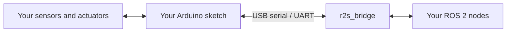

# ros2serial

**Bring your microcontroller's sensors and actuators into ROS 2 over serial.**

Keep the hardware driver on your Arduino. Publish its readings as ROS messages,
subscribe to commands from your robot, and let a regular ROS 2 bridge node handle
the host side. The firmware needs no RTOS or network stack, and runs on small
boards including the 8-bit Arduino Uno.

[](https://github.com/apojomovsky/ros2serial/actions/workflows/ci.yml)



**Under active development.** This guide follows `master`. Uno and Mega firmware
is tested in simulation; real-board validation is still tracked in
[#95](https://github.com/apojomovsky/ros2serial/issues/95).
The current wire format is protocol v4. Use matching firmware and host packages
from the same checkout.

## Connect your first board

This walkthrough uses an Arduino Uno, ROS 2 Jazzy on Linux, and Arduino CLI.
It assumes you can read your inputs and drive your outputs already. The example
publishes an active-low button on pin 2 as `/button` and subscribes to `/led`
to control `LED_BUILTIN`. These are independent topics: ROS decides what to do
with a button press.

### 1. Build in your ROS workspace

Start with ROS 2, colcon and rosdep installed and rosdep initialized.
See [Installation](docs/installation.md) for prerequisites and updates.

```sh
source /opt/ros/jazzy/setup.bash
mkdir -p ~/ros2_ws/src
cd ~/ros2_ws/src
git clone https://github.com/apojomovsky/ros2serial.git
cd ~/ros2_ws
rosdep install --from-paths src --ignore-src -r -y
colcon build --packages-up-to r2s_bridge r2s_gen --cmake-args -DBUILD_TESTING=OFF
source install/setup.bash
ros2 run r2s_gen r2s-gen version
```

The host build does not compile or flash your Arduino. The next step prepares
the firmware using tools installed by the workspace.

### 2. Compile and upload

Install Arduino CLI and its AVR core as described in
[Installation](docs/installation.md#arduino-cli). From `~/ros2_ws`:

```sh
ros2 run r2s_gen r2s-arduino library --out firmware/ros2serial
ros2 run r2s_gen r2s-arduino compile \
  --library firmware/ros2serial --fqbn arduino:avr:uno \
  --out firmware/build firmware/ros2serial/examples/button_led
arduino-cli board list
```

Use the port reported for your board in both the upload and launch commands.
Here it is `/dev/ttyACM0`:

```sh
arduino-cli upload --port /dev/ttyACM0 --fqbn arduino:avr:uno \
  --input-dir firmware/build firmware/ros2serial/examples/button_led
```

The library command includes the core, Arduino port, message headers, and
examples. The compile command supplies the required buffer and feature settings
to both the sketch and the library. For a Mega, replace the FQBN in both commands
with `arduino:avr:mega`.

### 3. Start the bridge

In a terminal with the workspace sourced:

```sh
ros2 launch r2s_bridge r2s_bridge.launch.py port:=/dev/ttyACM0
```

Opening an Uno's port resets it. Allow the bootloader and handshake to finish.
Keep this terminal running and close any Arduino serial monitor using the port.

### 4. Use the topics

In another terminal:

```sh
source ~/ros2_ws/install/setup.bash
ros2 topic echo /button std_msgs/msg/Bool
```

The sketch repeats the debounced state at 10 Hz: `data: true` means pressed,
`data: false` means released. Stop the echo with Ctrl-C, then turn the LED on:

```sh
ros2 topic pub --once /led std_msgs/msg/Bool '{data: true}'
```

Send `{data: false}` to turn it off. Your ROS nodes can now use these topics
like other publishers and subscriptions. The host needs no topic configuration:
the firmware announces its names and types when it connects.

## Make it part of your robot

| I want to… | Read |
| --- | --- |
| Add publishing and subscriptions to my sketch | [Firmware guide](docs/firmware.md) |
| Start the bridge with my robot; rename topics or connect several boards | [Robot integration](docs/robot-integration.md) |
| Use my own `.msg` files and generate sources with colcon | [Custom interfaces](docs/custom-interfaces.md) |
| Use parameters, services, or understand action support | [Services and parameters](docs/services-and-parameters.md) |
| Find an example for a sensor or actuator | [Examples](examples/README.md) |
| Port a ROS 1 rosserial sketch | [Migration guide](docs/03-port-rosserial-sketch.md) |
| Diagnose a board that does not connect | [Troubleshooting](docs/troubleshooting.md) |
| Try the system without a board | [Without hardware](docs/without-hardware.md) |

## Where it fits

ros2serial is for serial-attached microcontrollers where firmware size and a
simple publish/subscribe API matter. Common message types are bundled; custom
interfaces are generated ahead of time. Strings and arrays have explicit bounds
so the MCU can allocate its storage at compile time. On AVR, `float64` fields
have the precision of the board's 32-bit `double`.

The bridge targets ROS 2 Jazzy, Lyrical and Rolling. Uno and Mega have simulated
end-to-end coverage. ESP32 examples and the CH32V003, STM32F103 and RP2040 ports
have build coverage; that does not establish real-hardware validation. PIC
support remains development work. Measurements are in
[Size and stack budgets](docs/budgets.md).

Topics use best-effort serial delivery: this is not full DDS QoS on the MCU.
Parameters and services use a separate reliable channel. Host action integration
is still being completed. WiFi and other network transports are outside the
project's scope.

Coming from **rosserial**, you get the same basic sketch-to-ROS workflow in ROS 2,
with a compatibility API for existing sketches. **micro-ROS** provides a broader
ROS client environment on supported embedded platforms through a DDS-XRCE agent.
ros2serial focuses on a small firmware library and a serial bridge,
including 8-bit boards.

## Developing ros2serial

Users work in native ROS workspaces. Contributors use the pinned Docker image
and `make` entry points described in [Contributing](CONTRIBUTING.md).
The [design](docs/00-design.md) explains the implementation and
[protocol specification](spec/protocol.md) defines the wire format.

MIT licensed; see [LICENSE](LICENSE). Bundled message definitions retain their
Apache 2.0 attribution.
