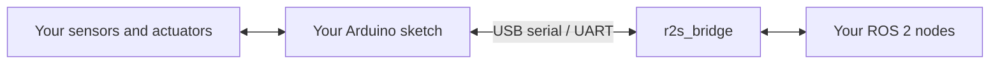

<div align="center">

<picture>
  <source media="(prefers-color-scheme: dark)" srcset="docs/artwork/ros2serial-white.png">
  <source media="(prefers-color-scheme: light)" srcset="docs/artwork/ros2serial.png">
  
</picture>

# ros2serial

[](https://github.com/apojomovsky/ros2serial/actions/workflows/ci.yml)
[](https://github.com/apojomovsky/ros2serial/releases)
[](LICENSE)
[](docs/installation.md)

</div>

**Bring your microcontroller's sensors and actuators into ROS 2 over serial.**

Keep the hardware driver on your Arduino. Publish its readings as ROS messages,
subscribe to commands from your robot, and let a regular ROS 2 bridge node handle
the host side. The firmware needs no RTOS or network stack, and runs on small
boards including the 8-bit Arduino Uno.



**Under active development.** This guide follows `master`. Uno and Mega firmware
is tested in simulation on every pull request; ESP32 and the other ports are
built in CI, which proves they compile, not that they run on hardware. Real
board results are recorded on [Real-board
validation](docs/hardware-validation.md) as the maintainer fills them in.
The current wire format is protocol v4, and it is not frozen: it may change
between releases. Use matching firmware and host packages from the same
checkout.

## Connect your first board

This walkthrough uses an Arduino Uno, ROS 2 Jazzy on Linux, and Arduino CLI.
It assumes you can read your inputs and drive your outputs already. The example
publishes an active-low button on pin 2 as `/button` and subscribes to `/led`
to control `LED_BUILTIN`. These are independent topics: ROS decides what to do
with a button press.

### 1. Build in your ROS workspace

Start with ROS 2, colcon and rosdep installed and rosdep initialized.
See [Installation](docs/installation.md) for prerequisites and updates.

```sh
source /opt/ros/jazzy/setup.bash
mkdir -p ~/ros2_ws/src
cd ~/ros2_ws/src
git clone https://github.com/apojomovsky/ros2serial.git
cd ~/ros2_ws
rosdep install --from-paths src --ignore-src -r -y
colcon build --packages-up-to r2s_bridge r2s_gen --cmake-args -DBUILD_TESTING=OFF
source install/setup.bash
ros2 run r2s_gen r2s-gen version
```

The host build does not compile or flash your Arduino. The next step prepares
the firmware using tools installed by the workspace.

### 2. Compile and upload

Install Arduino CLI and its AVR core as described in
[Installation](docs/installation.md#arduino-cli). From `~/ros2_ws`:

```sh
ros2 run r2s_gen r2s-arduino library --out firmware/ros2serial
ros2 run r2s_gen r2s-arduino compile \
  --library firmware/ros2serial --fqbn arduino:avr:uno \
  --out firmware/build firmware/ros2serial/examples/button_led
arduino-cli board list
```

Use the port reported for your board in both the upload and launch commands.
Here it is `/dev/ttyACM0`:

```sh
arduino-cli upload --port /dev/ttyACM0 --fqbn arduino:avr:uno \
  --input-dir firmware/build firmware/ros2serial/examples/button_led
```

The library command includes the core, Arduino port, message headers, and
examples. The compile command supplies the bundle's codec flag and its frame, nesting
and topic limits to both the sketch and the library; it enables no optional
channel. For a Mega, replace the FQBN in both commands
with `arduino:avr:mega`.

#### Or use the Arduino IDE

If you prefer the IDE, download `ros2serial-arduino-<version>.zip` from the
[releases page](https://github.com/apojomovsky/ros2serial/releases), then choose
*Sketch > Include Library > Add .ZIP Library* and pick the file. That archive
carries the core, the port glue, the message headers and the sketches, so its
examples appear under *File > Examples > ros2serial* and compile as they are.
The archive carries its own `src/r2s_config.h`, so the IDE needs no build
property and nothing else configured. The [firmware
guide](docs/firmware.md#the-frame-limit-is-a-build-input) says where each
route gets its limits.

A library for your own interface types installs the same way: `r2s-gen types`
writes the archive with `--zip`. [Custom messages in the Arduino
IDE](docs/arduino-ide-custom-messages.md) walks that path end to end, from your
own `.msg` to a board publishing it.

### 3. Start the bridge

In a terminal with the workspace sourced:

```sh
ros2 launch r2s_bridge r2s_bridge.launch.py port:=/dev/ttyACM0
```

Opening an Uno's port resets it. Allow the bootloader and handshake to finish.
Keep this terminal running and close any Arduino serial monitor using the port.

### 4. Use the topics

In another terminal:

```sh
source ~/ros2_ws/install/setup.bash
ros2 topic echo /button std_msgs/msg/Bool
```

The sketch repeats the debounced state at 10 Hz: `data: true` means pressed,
`data: false` means released. Stop the echo with Ctrl-C, then turn the LED on:

```sh
ros2 topic pub --once /led std_msgs/msg/Bool '{data: true}'
```

Send `{data: false}` to turn it off. Your ROS nodes can now use these topics
like other publishers and subscriptions. The host needs no topic configuration:
the firmware announces its names and types when it connects.

### 5. Check the board with one command

From the repository root, with the board plugged in, the dev image built
(`make image`) and the port from `arduino-cli board list`:

```sh
make hardware-check PORT=/dev/ttyACM0 BOARD=uno
```

It flashes the `button_led` example, starts the bridge, samples `/button`
for half a minute, reads the link counters, drives `/led` and asks you
whether the LED lit. Nothing ROS or Arduino related is installed on your
host: the command runs in the contributor image and passes the device in
with its own group, so your user need not be in `dialout`. It ends with one
block to paste into a report:

```text
== ros2serial hardware check
board: uno
port: /dev/ttyACM0
firmware: arduino_button_led arduino:avr:uno
flash: 11640 bytes
ram: 1181 bytes
handshake: 4.3 s
button rate: 10.0 Hz from 297 messages
longest gap: 120 ms
crc errors: 0
rx overflows: 0
dropped frames: 0
sequence gaps: 0
dropped topic frames: 0
led: lit
verdict: PASS
```

`verdict: FAIL` prints a `failed:` line per reason: a rate outside 8 to
12 Hz, a silence longer than 300 ms, a nonzero counter, or an LED you did not
see light. The format and both verdicts are documented in
[Without hardware](docs/without-hardware.md#checking-a-real-board).

## Make it part of your robot

| I want to… | Read |
| --- | --- |
| Add publishing and subscriptions to my sketch | [Firmware guide](docs/firmware.md) |
| Choose how to declare my topics | [Declaring topics](docs/declaring-topics.md) |
| Build in C, with CMake or PlatformIO, or on my own board | [C and bare metal](docs/c-and-bare-metal.md) |
| Start the bridge with my robot; rename topics or connect several boards | [Robot integration](docs/robot-integration.md) |
| Use my own `.msg` files and generate sources with colcon | [Custom interfaces](docs/custom-interfaces.md) |
| Take my own `.msg` to a board from the Arduino IDE | [Custom messages in the Arduino IDE](docs/arduino-ide-custom-messages.md) |
| Emit a library for my own types, without `r2s.yaml` | [The library route](docs/type-library.md) |
| Set or change the storage bound of a message field | [Message bounds](docs/message-bounds.md) |
| See the limits the bundled types ship with | [Message bounds](docs/message-bounds.md#the-built-in-types-limits) |
| Use parameters, services, or understand action support | [Services and parameters](docs/services-and-parameters.md) |
| Find an example for a sensor or actuator | [Examples](examples/README.md) |
| Port a ROS 1 rosserial sketch | [Migration guide](docs/03-port-rosserial-sketch.md) |
| Run ros2serial on a board of my own | [Porting guide](docs/04-porting.md) |
| Diagnose a board that does not connect | [Troubleshooting](docs/troubleshooting.md) |
| Try the system without a board | [Without hardware](docs/without-hardware.md) |
| See what was validated on real boards | [Real-board validation](docs/hardware-validation.md) |

## Where it fits

ros2serial is for serial-attached microcontrollers where firmware size and a
simple publish/subscribe API matter. Common message types are bundled; custom
interfaces are generated ahead of time. Strings and arrays have explicit bounds
so the MCU can allocate its storage at compile time, and [message
bounds](docs/message-bounds.md) says where each one comes from. On AVR, `float64`
fields have the precision of the board's 32-bit `double`.

A sketch declares its topics as C++ objects at run time, or as an X-macro list
that keeps them in flash; [Declaring topics](docs/declaring-topics.md) explains
which to pick and what each costs. Firmware that is compiled as C, or built
without the Arduino library, has its own page: [C and bare
metal](docs/c-and-bare-metal.md).

The bridge targets ROS 2 Jazzy, Lyrical and Rolling. Uno and Mega have simulated
end-to-end coverage. ESP32 examples and the CH32V003, STM32F103 and RP2040 ports
are built in CI; that does not establish real-hardware validation. PIC support
remains development work. Measurements are in
[Size and stack budgets](docs/budgets.md), and [Real-board
validation](docs/hardware-validation.md) records what was checked on physical
boards.

Topics use best-effort serial delivery: this is not full DDS QoS on the MCU.
Parameters and services use a separate reliable channel. Actions are served on
the MCU through `r2s::action::Server` or the `R2S_ACTIONS` rows of the C API,
and the bridge presents them as a ROS 2 action server, proven end to end on
posix and avr (see [Services and parameters](docs/services-and-parameters.md)).
WiFi and other network transports are outside the project's scope.

Coming from **rosserial**, you get the same basic sketch-to-ROS workflow in ROS 2,
with a compatibility API for existing sketches. **micro-ROS** provides a broader
ROS client environment on supported embedded platforms through a DDS-XRCE agent.
ros2serial focuses on a small firmware library and a serial bridge,
including 8-bit boards.

## Developing ros2serial

Users work in native ROS workspaces. Contributors use the pinned Docker image
and `make` entry points described in [Contributing](CONTRIBUTING.md).
The [design](docs/00-design.md) explains the implementation and
[protocol specification](spec/protocol.md) defines the wire format.

MIT licensed; see [LICENSE](LICENSE). Bundled message definitions retain their
upstream attribution: Apache 2.0 for `common_interfaces` and `rcl_interfaces`,
BSD 3-Clause for the `tf2_msgs` types.
