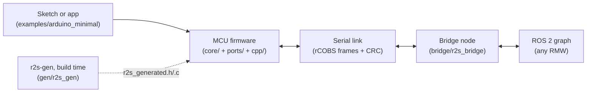
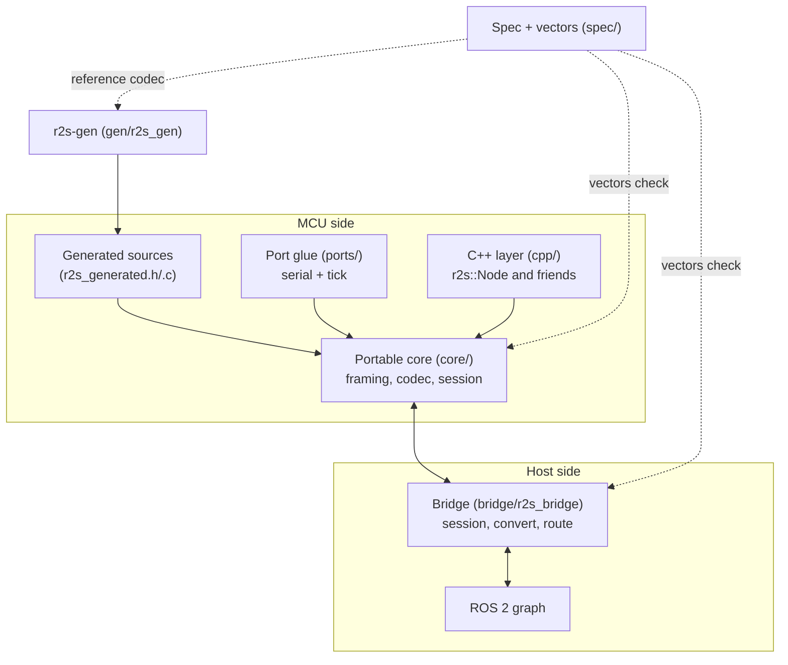
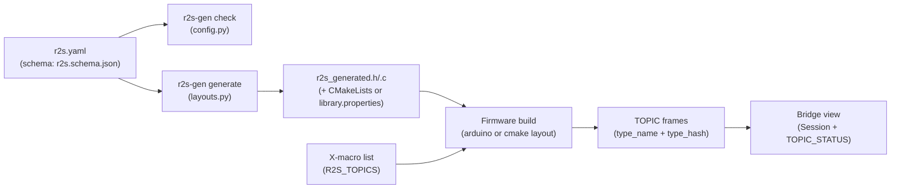
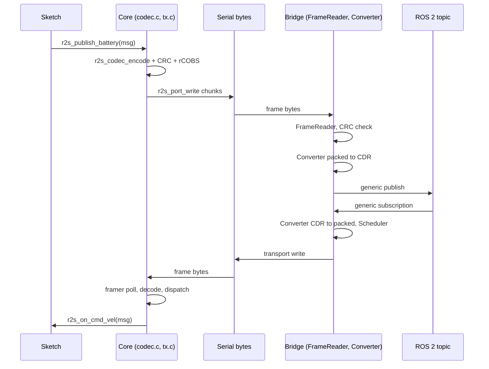
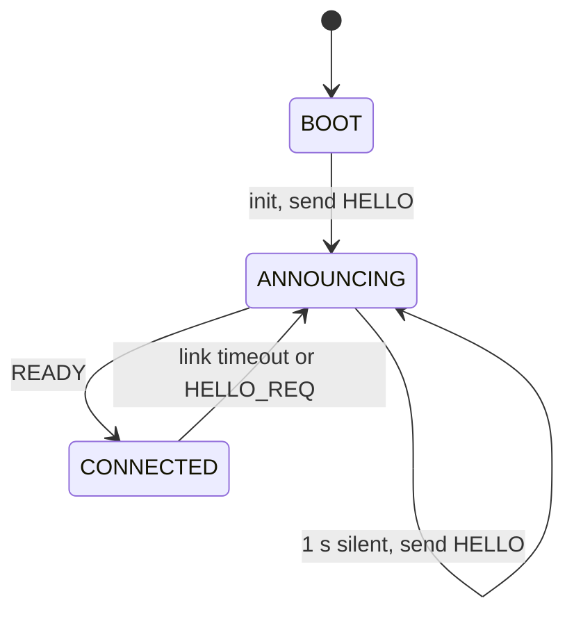
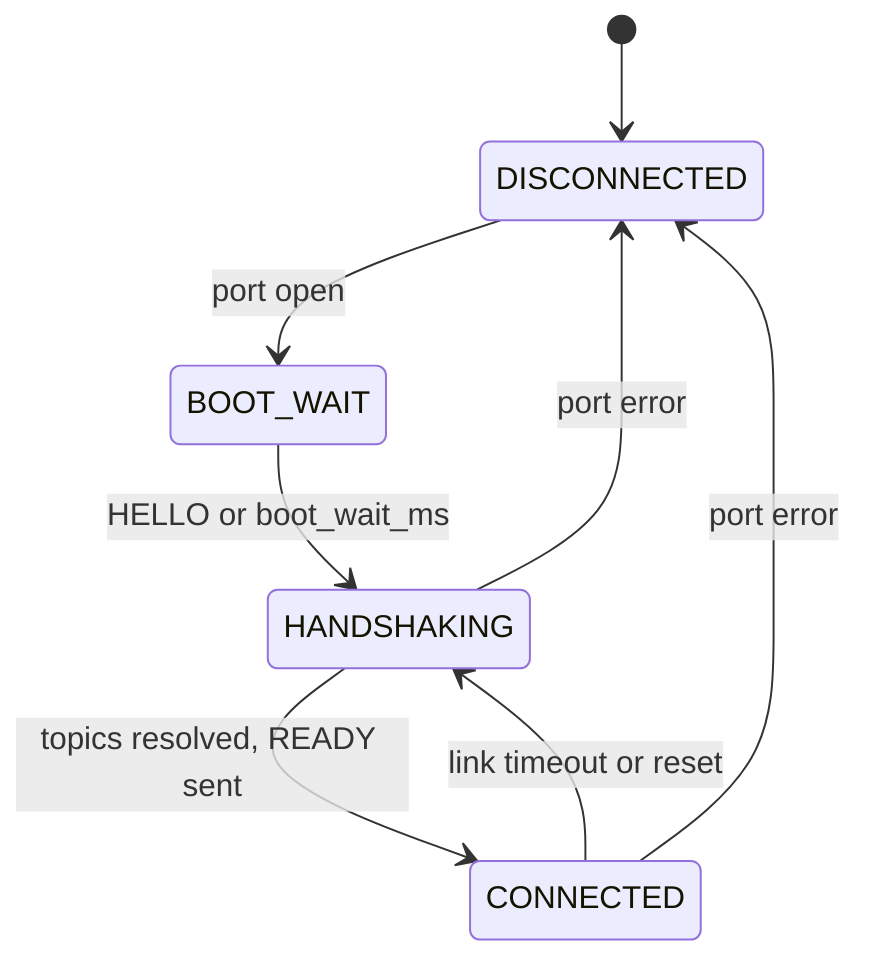

# ros2serial architecture

A map from the repository to the running system, for contributors. The
specification stays in [00-design.md](00-design.md) and
[spec/protocol.md](../spec/protocol.md); this page shows where each part
of it lives in the tree. Every name below is a real directory, file or
symbol on `master`.

## Context

A sketch publishes and subscribes through the core or the C++ layer,
and the firmware exchanges rCOBS frames with one bridge node over a
serial link. The bridge republishes the MCU topics on the ROS 2 graph
and forwards subscriptions back. `r2s-gen` runs at build time only: it
turns the topic list into C sources the firmware compiles, so no Python
ships on either side of the wire. The wire today is protocol v2
([GEN-2] in `spec/protocol.md`). Parameters (ID 3) and the
reliable-channel ack (ID 6) stay reserved under [SYS-3] pending S5, and
services and actions stay out pending S8, so no section here claims
their behavior. See [Part I, Architecture](00-design.md#architecture)
and [Part I, Declaring topics](00-design.md#declaring-topics).

## Containers

The core compiles with no ROS and no hardware: ports implement the
`r2s_port.h` contract (`r2s_port_read`, `r2s_port_write`,
`r2s_port_tx_free`, `r2s_port_tick`), with `_link` variants where a port
hosts several links, and the C++ layer calls the same C
API a C sketch calls. The bridge reuses the core framing sources
(`core/src/framer.c`, `rcobs.c`, `crc.c`) compiled for the host, so
framing has one implementation, with one framer instance per live link
(up to 16 per bridge process). `spec/vectors/` checks all
three implementations. Launch arguments place the node in a namespace
and remap the MCU topics. See [Part II, Repository layout](00-design.md#repository-layout)
and [Part II, Test strategy](00-design.md#test-strategy).

| Box | Directory | Test scope |
| --- | --- | --- |
| Portable core | `core/` | `CORE=1` |
| Port glue | `ports/arduino`, `ports/posix` | `E2E=posix`, `E2E=avr` |
| C++ layer | `cpp/` | `CPP=1` |
| Generated sources | `gen/` output, `r2s_generated.h` | `GEN=1` |
| Bridge | `bridge/` | `BRIDGE=1` |
| Spec and vectors | `spec/` | every scope, via vectors |
| Generator | `gen/r2s_gen` | `GEN=1` |

`ports/avr`, `ports/stm32`, `ports/ch32v` and `ports/epic-hal` hold the
planned 32-bit and PIC ports; each currently carries only a `.gitkeep`.

## Generation pipeline

`r2s-gen check` validates `r2s.yaml` without emitting anything, and
`r2s-gen generate --layout arduino|cmake` emits the structs (`emit.py`),
the descriptors (`descriptors.py`), the topic table and publish
wrappers (`topics.py`), with bounds resolved by `bounds.py`. Layouts today
are `arduino` and `cmake`; `compact` handshakes need the node map, which
`generate` does not emit yet, so use `handshake: full`. The
firmware announces each topic in a TOPIC frame; the bridge resolves the
type support, compares the hash, and answers TOPIC_STATUS. Sketches that
skip the generator use the X-macro list instead and announce the same
frames. C++ output (`--cpp`) is not emitted yet. See
[Part I, Declaring topics](00-design.md#declaring-topics) and
[Part II, Code generator specification](00-design.md#code-generator-specification).

## Following one message

A publish serializes field by field from the descriptors, appends the
CRC, and encodes rCOBS straight to the port in `R2S_TX_CHUNK` pieces; a
full link returns `R2S_ERR_TX_BUSY` instead of blocking. The bridge
decodes with the same core sources, converts packed to CDR with cached
plans, and publishes through a generic publisher. The subscribe path
mirrors it: CDR to packed, the Scheduler rate-limits and round-robins
host to MCU traffic, and `r2s_spin_some` dispatches to the
`r2s_on_<name>` handler. System channels use reserved topic IDs
(heartbeat is ID 4); user topics start at 16. See
[Part I, Wire encoding](00-design.md#wire-encoding-packed-converted-on-the-host),
[Part I, Receiving and sending bytes](00-design.md#receiving-and-sending-bytes),
and [Part II, Implementation pointers](00-design.md#implementation-pointers).

## Session state machine

The diagrams below follow `spec/protocol.md`, sections 8.1 and 8.2. In
code the MCU states are the `ANNOUNCING` and `CONNECTED` values in
`core/src/session.c` (`BOOT` is the init path that sends the first
HELLO), and the host states are the `SessionState` values in
`bridge/r2s_bridge/include/r2s_bridge/session.hpp`. The reliable
channel rides these two machines without claiming a transition here.
Pending work adds rules the same way: parameters in #155, services in
#156, actions in #317 to #320.

While announcing, the MCU answers any non-handshake host frame with a
rate-limited HELLO and its publish calls fail with
`R2S_ERR_NOT_CONNECTED`. While connected it heartbeats every
`R2S_HEARTBEAT_MS` and publishes for topics the host accepted. The host
waits `boot_wait_ms` after opening the port (a Uno resets on open),
walks one TOPIC_REQ per index with retries, sends READY with a nonzero
token, then heartbeats and runs the time sync (PING, PONG,
CORRECTION on ID 1). A HELLO with a new token means the MCU reset. See
[Part I, Protocol draft](00-design.md#protocol-draft-v1) and
[Part II, Protocol details](00-design.md#protocol-details).
